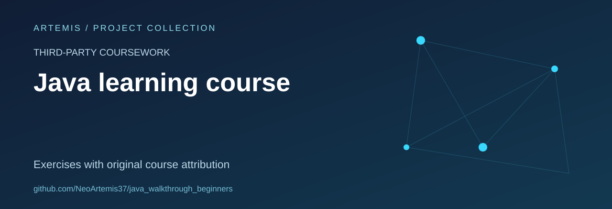

# Java Learning Workbook

A personal study copy of the **Java for beginners** course, organised as small exercises and Java source files.

**Status:** learning archive. This repository does not claim to be the original author of the course material.

## Course provenance

[`course-info.yaml`](course-info.yaml) identifies the course as an English-language JetBrains Marketplace learning resource originally created for students of **Hsinchu International School in Taiwan**, then released for the general public. It links to the [Java for beginners course listing](https://plugins.jetbrains.com/plugin/18905-java-for-beginners).

Keep that attribution when sharing the exercises. An upstream course licence has not been independently established by this repository.

## Learning path

The actual folder structure covers:

1. Fundamentals, including structure, variables and operators.
2. Flow control and conditionals.
3. Objects and methods.
4. Arrays and string methods.
5. ArrayList and two-dimensional arrays.

Exercises include source files, task descriptions and, where present, test fixtures. The course metadata describes the material as a complement to a regular programming course.

## Explore and study

Open an exercise folder, read its `task.md`, then inspect the corresponding `src/` and `test/` files. The repository includes Gradle configuration and educational-plugin metadata. The checked-in build targets Java 8 source compatibility; a modern JDK/Gradle combination has not been verified here.

There is no Gradle wrapper in the snapshot, so a one-command portable setup is not claimed.

## Repository maintenance

Useful improvements include recording the upstream version, clarifying course reuse terms and documenting a verified development environment. This archive shows practice and progression, rather than a standalone application or a newly authored course.
